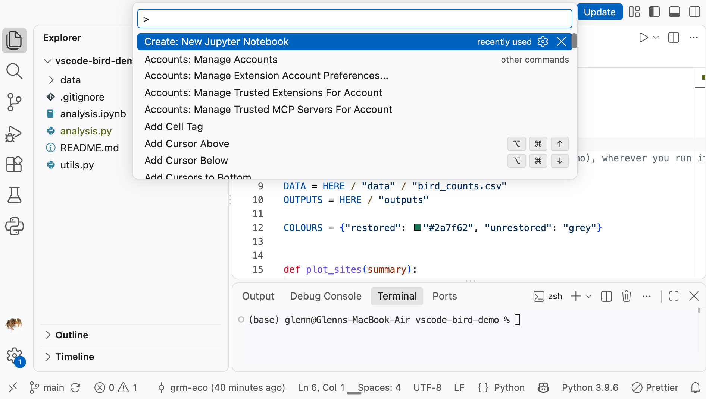
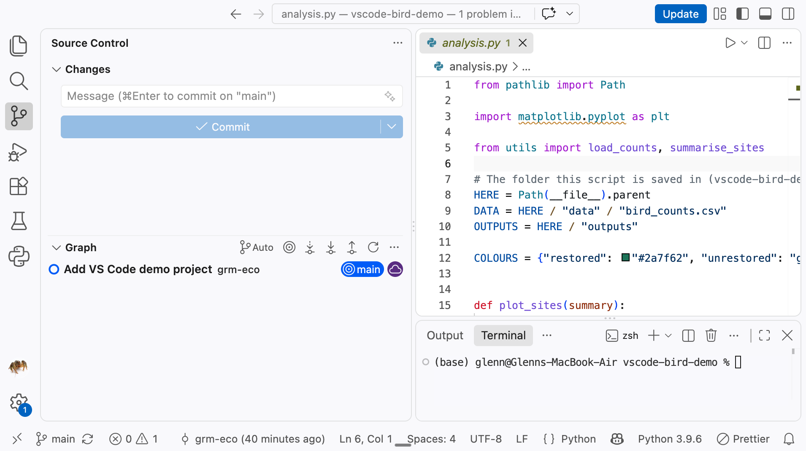

This started as a one-hour live demo, but it's written so you can work through it on your own afterwards. It assumes you use R and RStudio and are curious about VS Code. It doesn't assume you know much Python, and it won't teach you Python either. The Python here is kept short so that the focus stays on VS Code.

VS Code is a free, general-purpose code editor used very, very widely for a variety of languages. Out of the box it knows very little about any one language. You add what you need with extensions, so the same editor can handle Python or R (and many other languages). Many people who move from RStudio to VS Code do it because they've started using Python, which is where this tutorial focuses.

We'll use one small synthetic example the whole way through: bird counts from six fynbos sites, three restored and three unrestored, each visited four times. We'll open a notebook that loads the data, works out the mean count per site and plots it, and then look at the same analysis as a script.

There's a setup guide and a cheat sheet at the end of the page, and a reference section on translating R habits to Python. If you're coming to the live session, do the [setup](#setting-up-your-own-computer) beforehand.

## Outline

| Start | Topic | Minutes |
|---|---|---|
| 0:00 | Introduction and the example project | 3 |
| 0:03 | Workspace orientation | 8 |
| 0:11 | Extensions | 6 |
| 0:17 | Environments with mamba | 12 |
| 0:29 | Working in Jupyter | 15 |
| 0:44 | Inspecting data, plots and help | 5 |
| 0:49 | Git and the Source Control panel | 8 |
| 0:57 | Wrapping up | 3 |
| | R to Python translation (reference only) | |

### The example project

The example project is a repository in the lab's GitHub organisation: https://github.com/PiNC-lab/vscode-bird-demo. You'll make your own copy of it on GitHub (a **fork**), copy that to your computer (**clone** it), and at the end push a change back to your fork. If forks are new to you, the [Git and GitHub tutorial](git-github.qmd#the-lab-organisation-forks-and-pull-requests) explains them.

1. Go to https://github.com/PiNC-lab/vscode-bird-demo, click **Fork**, then **Create fork**. Your copy is at `https://github.com/your-username/vscode-bird-demo`.
2. On your fork, click the green **Code** button and copy the HTTPS address.
3. In VS Code, open the Welcome page (**Help > Welcome**) and click **Clone Git Repository...**. Paste the address, press **Enter**, choose a folder to put the project in, and click **Open** when VS Code asks.

The terminal equivalent is `git clone https://github.com/your-username/vscode-bird-demo.git`, followed by **File > Open Folder...**.

The project contains:

```
vscode-bird-demo/
├── data/
│   └── bird_counts.csv   the data
├── .gitignore            files Git should leave alone
├── analysis.ipynb        a notebook that runs the analysis
├── analysis.py           the same analysis as a script
├── README.md
└── utils.py              functions used by both
```

During the tutorial you'll add an `environment.yml` (section 3), and in section 6 you'll commit it and push it to your fork.

The data have one row per site visit:

```
site,treatment,visit_date,count
S01,restored,2026-03-02,12
S01,restored,2026-04-06,15
...
S03,restored,2026-04-06,
...
```

One visit has no count, which comes up later.

## 1. Workspace orientation

### Open a folder

In RStudio you work inside a Project, which sets the working directory and remembers your open files. The VS Code equivalent is simply a folder. Cloning the example project opened its folder for you. Next time, use **File > Open Folder...** (or **File > Open Recent**) and choose `vscode-bird-demo`.

The folder you open is the **workspace**. The file explorer, search, the terminal, Git and Python all work relative to it, and VS Code remembers your open tabs and layout for that folder. Any settings specific to the project are kept in a `.vscode` folder inside it, a bit like the `.Rproj` file.

Always open the project folder, not a single file. Lots of things (imports, relative paths, Git, picking a Python environment) only work properly when VS Code knows which folder is the project.

### A tour of the window

{fig-alt="VS Code window showing the Activity Bar, the Explorer listing the vscode-bird-demo files, analysis.py open in the editor, a terminal panel at the bottom, and the status bar showing the main branch and Python 3.9.6."}

| Area | What it is | Closest thing in RStudio |
|---|---|---|
| **Activity Bar** | The column of icons down the far left. Each one switches what's shown in the side bar: Explorer, Search, Source Control, Run and Debug, Extensions | The tabs across the top of each pane |
| **Side Bar** | Shows whichever view you picked in the Activity Bar. **Explorer** is the file tree | Files pane |
| **Editor** | Your open files, in tabs. Drag a tab to the side, or use **Cmd/Ctrl + \\**, to split the editor | Source pane |
| **Panel** | Along the bottom: **Terminal**, **Problems** (errors and warnings), **Output** (logs) and others | Console and Terminal |
| **Status Bar** | The strip along the bottom: current Git branch, errors and warnings, the selected Python environment, line number and file type | |

The terminal opens in the workspace folder. It's an ordinary shell (zsh on a Mac, PowerShell on Windows), the same as RStudio's Terminal tab. There's no separate R-style console. In Python you either run code in a notebook, run a whole script from the terminal, or send lines to an interactive Python session, which we'll come to in section 4.

### The Command Palette

VS Code has a huge number of features, and keyboard shortcuts are often the quickest way to get to them. The [cheat sheet](#cheat-sheet) at the end of this page lists the ones I find most useful. If you learn one shortcut, make it **Cmd/Ctrl + Shift + P**. This opens the **Command Palette**, a search box for every command VS Code and your extensions provide. Start typing what you want and pick it from the list. It also shows each command's keyboard shortcut, so it's how you learn them.

{fig-alt="The VS Code Command Palette open at the top of the window, with an empty search box and a list of commands, some showing their keyboard shortcuts."}

## 2. Extensions

Click the **Extensions** icon in the Activity Bar. Search for an extension, check the publisher, and click **Install**.

Anyone can publish an extension, so stick to well-used ones from publishers you recognise.

### The essentials

| Extension | Publisher | What it does |
|---|---|---|
| **Python** | Microsoft | Running and debugging Python, finding and selecting environments. Installing it also installs Pylance |
| **Pylance** | Microsoft | Autocomplete, hover help, go to definition, and underlining mistakes as you type |
| **Jupyter** | Microsoft | Jupyter notebooks inside VS Code, plus the variables view |

### Useful extras

| Extension | Publisher | What it does |
|---|---|---|
| **Data Wrangler** | Microsoft | A spreadsheet-style viewer for data frames, much like `View()`. Covered in section 5 |
| **Ruff** | Astral Software | Tidies up your code formatting and points out common mistakes, like `styler` and `lintr` in R |
| **Rainbow CSV** | mechatroni | Colours each column of a CSV file differently so you can read it. Open `data/bird_counts.csv` to see it |
| **Quarto** | Quarto | Editing and previewing Quarto documents, including this website |

## 3. Environments with mamba

### Why environments matter

In R, you generally have one library of packages, shared by every project on your computer. `install.packages("dplyr")` updates dplyr for all of them at once. Usually that's fine. Occasionally an update breaks an old project, which is the problem `renv` solves.

In Python, that problem turns up much sooner. Packages are pickier about which versions of each other they'll work with, and your computer may already have a Python on it that the operating system relies on. So the normal way to work in Python is to give each project its own **environment**: a folder containing a particular version of Python and the packages that project needs, kept separate from everything else. You never install packages into the system Python that came with your computer.

We use **mamba** to create and manage environments. It's a fast drop-in replacement for `conda` and accepts the same commands, so anything you read about `conda` works with `mamba` too.

### Create an environment

Open the terminal and run:

```bash
mamba create -n bird-demo -c conda-forge python=3.12 pandas matplotlib ipykernel jupyter
```

- `-n bird-demo` names the environment.
- `-c conda-forge` says where to get packages from. Miniforge (see the setup guide) uses conda-forge by default, but saying so does no harm.
- `python=3.12` fixes the Python version.
- `pandas` is for data frames and `matplotlib` for plots.
- `ipykernel` lets Jupyter notebooks use this environment. Install it in every environment you want to use from a notebook.
- `jupyter` adds the rest of the Jupyter tools

Mamba lists what it's going to install and then does it. To use the environment in the terminal, **activate** it:

```bash
mamba activate bird-demo
python --version
```

The prompt now starts with `(bird-demo)`. Commands like `python` and `mamba install` apply to that environment until you `mamba deactivate` or close the terminal.

To add a package later, activate the environment and install it:

```bash
mamba install -c conda-forge seaborn
```

To list your environments, use `mamba env list`.

### Other package management options

You'll come across two other tools in instructions online.

**pip** is Python's own package installer. It installs from PyPI, the main Python package index, rather than from conda-forge. Use mamba where you can, and pip only for a package that isn't on conda-forge. If you do, activate the environment first so the package goes into it, use pip after you've installed everything you can with mamba, and add the package to `environment.yml` by hand (under a `pip:` entry), because the export below leaves it out.

**uv** is a newer and very fast tool that does pip's job and also creates project environments, with a lock file that pins exact versions, much like `renv`. It's popular for projects that only use Python packages. Like pip, it installs from PyPI, so for spatial work that relies on compiled libraries such as GDAL, mamba and conda-forge are usually less trouble. Pick one tool per project rather than mixing them.

### Select the interpreter and the kernel

VS Code needs to know which environment to use, and there are two separate places to tell it.

**The interpreter** is used for Python scripts (`.py` files): running them with the Run button, autocomplete and error checking, and new terminals. Click the Python version in the bottom right of the Status Bar, or run **Python: Select Interpreter** from the Command Palette, and pick `bird-demo`. If it isn't listed, click the refresh icon or close and reopen VS Code.

**The kernel** is used by a Jupyter notebook. Each notebook has its own, chosen with **Select Kernel** at the top right of the notebook. We'll do this in section 4.

They're separate because a notebook remembers its own kernel. In practice you'll usually set both to the same environment. If a notebook says it can't find a package that you know is installed, the first thing to check is which kernel it's using.

When you select an interpreter, VS Code normally activates that environment in new terminals for you. If the prompt doesn't show `(bird-demo)`, run `mamba activate bird-demo` yourself.

### Reproducibility with environment.yml

`renv.lock` records which R packages a project needs so someone else can rebuild its library. The conda world's equivalent is an `environment.yml` file in the project folder. To write one:

```bash
mamba env export --from-history > environment.yml
```

`--from-history` lists only the packages you asked for, not every dependency mamba pulled in with them. That keeps the file short and lets it work on Windows, Mac and Linux alike. Open the file and delete the last line, which starts with `prefix:` and gives the location on your computer. You should be left with:

```yaml
name: bird-demo
channels:
  - conda-forge
dependencies:
  - ipykernel
  - jupyter
  - matplotlib
  - pandas
  - python=3.12
```

You can also write or edit this file by hand, which many people prefer. To recreate the environment from it, on another computer or after deleting it:

```bash
mamba env create -f environment.yml
```

After editing the file, bring an existing environment into line with:

```bash
mamba env update -f environment.yml --prune
```

Commit `environment.yml` to Git along with your code. Like `renv.lock`, it's what lets someone else (or you, in a year) run the project.

## 4. Working in Jupyter

A Jupyter notebook (`.ipynb`) mixes code, output and text in cells, much like an R Markdown or Quarto document, except that you run it interactively and the output is saved in the file.

### Open the notebook and choose a kernel

In the Explorer, click `analysis.ipynb`. It opens with the code and text but no output yet, because nothing has been run.

Click **Select Kernel** at the top right, then **Python Environments**, then `bird-demo`. Then click **Run All** in the notebook toolbar. Each cell runs in turn and its output appears underneath it.

### A walk through the notebook

The notebook has a few short code cells, with text cells (Markdown) between them as headings.

The first two code cells set things up:

```python
%load_ext autoreload
%autoreload 2
```

```python
import matplotlib.pyplot as plt

from utils import load_counts, summarise_sites
```

The `%autoreload` lines are explained below. The `import` lines are Python's `library()`: they load matplotlib for plotting, and two functions from `utils.py`, which sits next to the notebook.

The next two cells load the data and summarise it:

```python
counts = load_counts("data/bird_counts.csv")
counts.head()
```

```python
site_means = summarise_sites(counts)
site_means
```

As in an R chunk, the last line of a cell is displayed, so you see the first five rows of `counts` and then the table of means.

The last cell draws the plot, which appears underneath it:

```python
colours = {"restored": "#2a7f62", "unrestored": "grey"}

fig, ax = plt.subplots()
ax.bar(
    site_means["site"],
    site_means["mean_count"],
    color=site_means["treatment"].map(colours),
)
ax.set_xlabel("Site")
ax.set_ylabel("Mean count per visit")
```

To run one cell, click in it and press **Shift + Enter**, which runs it and moves on to the next. A few more keys that save time: press **Esc** to leave a cell, then **A** or **B** adds a cell above or below, **M** turns the cell into Markdown (text) and **Y** back into code, and **D D** deletes it. Press **Enter** to go back into the cell and edit it.

### The kernel and "restart and run all"

The **kernel** is the Python session behind the notebook. It holds every variable you've created, in the order you ran the cells, which is not necessarily the order they appear in. Delete a cell, or edit one and not re-run it, and the kernel still has the old variables. This is the same trap as an RStudio session full of objects from code you've since changed.

So before you trust a result, or share or commit the notebook, click **Restart** and then **Run All** (both in the notebook toolbar). That's the notebook version of restarting R and knitting from scratch. If it runs from top to bottom without errors, the notebook really does produce what it shows.

Restart the kernel also when it seems stuck, or after installing a new package into the environment.

### Your own functions in a module

As an analysis grows, you'll want to reuse code across notebooks and scripts. In R you might keep functions in `R/functions.R` and `source()` it. In Python you put them in a `.py` file, called a **module**, and import from it. That's what `utils.py` is. Open it from the Explorer:

```python
import pandas as pd


def load_counts(path):
    """Read the bird count data and drop visits with no count."""
    counts = pd.read_csv(path, parse_dates=["visit_date"])
    return counts.dropna(subset=["count"])


def summarise_sites(counts):
    """Mean count per visit for each site."""
    return (
        counts
        .groupby(["site", "treatment"], as_index=False)
        .agg(mean_count=("count", "mean"))
    )
```

The indented block after `def` is the body of the function, and the text in triple quotes is its documentation, which shows up when you hover over the function name.

Python only reads a module the first time you import it. Without the two `%autoreload` lines at the top of the notebook, changes you make to `utils.py` would be ignored until you restarted the kernel. With them, the notebook rereads `utils.py` every time you run a cell.

### From notebook to script

Notebooks are good for exploring. For the version that produces your final results, a script is easier to run from start to finish, review in Git and run on a server.

To turn a notebook into a script, open the **...** menu in the notebook toolbar and choose **Export**, then **Python Script**. The exported file is a starting point. `analysis.py` in the project is the same analysis tidied up into functions:

```python
from pathlib import Path

import matplotlib.pyplot as plt

from utils import load_counts, summarise_sites

# The folder this script is saved in (vscode-bird-demo), wherever you run it from
HERE = Path(__file__).parent
DATA = HERE / "data" / "bird_counts.csv"
OUTPUTS = HERE / "outputs"

COLOURS = {"restored": "#2a7f62", "unrestored": "grey"}


def plot_sites(summary):
    fig, ax = plt.subplots()
    ax.bar(
        summary["site"],
        summary["mean_count"],
        color=summary["treatment"].map(COLOURS),
    )
    ax.set_xlabel("Site")
    ax.set_ylabel("Mean count per visit")
    return fig


def main():
    counts = load_counts(DATA)
    summary = summarise_sites(counts)
    print(summary)

    OUTPUTS.mkdir(exist_ok=True)
    fig = plot_sites(summary)
    fig.savefig(OUTPUTS / "site_means.png", dpi=150)


if __name__ == "__main__":
    main()
```

The plotting code is now a function, the steps of the analysis are in `main()`, and the file paths are built with `HERE`, so it works whichever folder you run it from.

The last two lines say "run `main()` only when this file is run directly". If another script or notebook does `from analysis import plot_sites`, it gets the function without running the whole analysis. It's a good habit for any script with more than a few lines in it.

To run it, in the terminal:

```bash
mamba activate bird-demo
python analysis.py
```

The summary table is printed and `outputs/site_means.png` appears in the Explorer. The **Run** button (the triangle at the top right of the editor) does the same thing using the interpreter you selected.

To run just a line or a selection, the way **Ctrl + Enter** works in RStudio, press **Shift + Enter**. It sends the code to a Python session in the terminal.

### R in VS Code (optional)

You can run R in VS Code too. A tidy way to do it is to give R its own mamba environment, in the same way as Python. conda-forge has R and most CRAN packages, with `r-` in front of the package name. In the terminal:

```bash
mamba create -n bird-r -c conda-forge r-base r-irkernel jupyter_client r-languageserver r-tidyverse
mamba activate bird-r
Rscript -e "IRkernel::installspec(name = 'bird-r', displayname = 'R (bird-r)')"
```

- `r-base` is R itself.
- `r-irkernel` lets Jupyter notebooks run R, and `jupyter_client` is needed to set it up. The last line registers it with Jupyter under the name **R (bird-r)**. You only need to run it once.
- `r-languageserver` gives autocomplete and hover help for R scripts in VS Code.
- `r-tidyverse` is an example. Add whatever packages your project needs, such as `r-sf` or `r-terra`.

To add a package later, use `mamba install -c conda-forge r-<package>` with the environment activated, rather than `install.packages()`. That way mamba knows about everything in the environment, and you get ready-built packages, including spatial ones that otherwise need GDAL and friends installed separately.

**In a notebook**, click **Select Kernel**, then **Jupyter Kernel...**, then **R (bird-r)**. The cells now run R instead of Python. If it isn't listed, close VS Code completely and open it again.

It works, but it isn't RStudio. If most of your work is R, RStudio is still the more comfortable place for it, and plenty of people use RStudio for R and VS Code for everything else.

::: {.callout-tip}
## Positron

[Positron](https://positron.posit.co) is a newer IDE from Posit, the company behind RStudio. It's built on the same foundations as VS Code, so almost everything on this page applies to it, but it adds RStudio-style features for both R and Python, such as a console, a variables pane and a plots pane. If you want VS Code but miss RStudio, it's worth a look.
:::

## 5. Inspecting data, plots and help

### The Variables view and Data Wrangler

RStudio's Environment pane lists every object in your session. In a notebook, click **Variables** in the notebook toolbar (if the window is narrow, it may be under **...**). A panel opens listing every variable in the kernel with its type, size and value.

Next to a data frame such as `counts` there's a button to open it in **Data Wrangler**. You'll also see an **Open 'counts' in Data Wrangler** button underneath a cell that displays a data frame.

Data Wrangler is the `View()` of VS Code. You can scroll, sort and filter, and each column has a summary with its type, missing values and distribution. Sorting and filtering here doesn't change your data. Data Wrangler also has an editing mode that writes pandas code for cleaning steps you make with the mouse, which you can copy back into the notebook. It's a handy way to find out how to do something in pandas.

### Where plots appear

In a notebook, a plot appears underneath the cell that made it and is saved in the notebook. Hover over it for buttons to expand it or save it as an image.

A script run from the terminal has nowhere to show a plot, so save it with `fig.savefig(...)`, as `analysis.py` does.

### Getting help

- **Hover** over any function to see its documentation. Try hovering over `summarise_sites` in the notebook, which shows the docstring from `utils.py`, and over `plt.subplots`.
- **Autocomplete** appears as you type. Type `counts.` and you get a list of everything a data frame can do. **Ctrl + Space** brings the list back if it disappears.
- When you type the opening bracket of a function call, VS Code shows its arguments.
- **F12**, or right-click and **Go to Definition**, jumps to where a function is defined, whether that's in `utils.py` or inside pandas itself.
- `help(plt.bar)` prints the full documentation, like `?barplot` in R. In a notebook, `plt.bar?` does the same.

## 6. Git and the Source Control panel

This section assumes you've done the [Git and GitHub tutorial](git-github.qmd), or know the basics of branches, commits and pushing. VS Code uses the same Git as RStudio, so nothing about your setup changes.

Because you cloned your fork, VS Code already knows the project is a Git repository, and that `origin` is your fork on GitHub. You'll put the `environment.yml` you made in section 3 on a new branch, commit it and push it.

Click the **Source Control** icon in the Activity Bar (it looks like a branching line), or press **Ctrl + Shift + G**. Files you've changed are listed under **Changes**, with a letter showing what happened: **U** for untracked (new) and **M** for modified. `environment.yml` is there with a **U**, and `analysis.ipynb` with an **M**, because running the notebook saved its output into the file.

{fig-alt="The VS Code Source Control view with an empty commit message box, a Commit button, and a Graph section listing one commit on the main branch; the status bar shows the main branch."}

1. **Clear the notebook's outputs.** Open `analysis.ipynb`, click **Clear All Outputs** in the notebook toolbar (it may be under **...**), and save. Outputs make notebooks bigger and their changes hard to read, so it's a good habit to clear them before committing. The notebook may still be marked **M**, because VS Code also saves which kernel it uses. That's fine to commit.
2. **Create a branch.** Click the branch name (`main`) at the bottom left of the Status Bar, choose **Create new branch...**, type `add-environment` and press **Enter**. The Status Bar now shows the new branch. Changes you haven't committed come with you.
3. **Stage.** Hover over the **Changes** heading and click **+** to stage everything. The files move to **Staged Changes**. This is ticking the boxes in RStudio's Git tab. (To stage just one file, use the **+** next to it. Click a file name to see what changed.)
4. **Commit.** Type a message such as `Add environment.yml` in the box at the top and click **Commit** (or press **Cmd/Ctrl + Enter**).
5. **Push.** Click **Publish Branch**. This creates the branch on your fork and pushes your commit to it. The first time, VS Code asks you to sign in to GitHub in your browser.

Refresh your fork on GitHub, pick `add-environment` from the branch menu, and `environment.yml` is there. From here you could open a pull request, as in the Git tutorial.

After the first push, the button becomes **Sync Changes**, which pulls and then pushes.

Everything in the Source Control view is a Git command underneath:

| In VS Code | In the terminal |
|---|---|
| Branch name > Create new branch | `git switch -c add-environment` |
| **+** on the Changes heading | `git add -A` |
| Commit | `git commit -m "Add environment.yml"` |
| Publish Branch | `git push -u origin add-environment` |
| Sync Changes | `git pull` then `git push` |

## 7. Wrapping up

- Open a folder, not a file. The folder is your project.
- **Cmd/Ctrl + Shift + P** finds any command.
- Give each project its own mamba environment, record it in `environment.yml`, and commit that file.
- Scripts use the interpreter, notebooks use a kernel. If an import fails, check which one is selected.
- Restart and run all before you trust a notebook.
- Put reusable functions in a `.py` file and import them, with `%autoreload` in notebooks.
- Move finished analyses into scripts with a `main()` function, and run them with `python script.py`.

## R to Python translation

This section is for reference. It wasn't part of the live session.

### Packages

| In R | In Python | Notes |
|---|---|---|
| dplyr, tidyr | [pandas](https://pandas.pydata.org), [polars](https://pola.rs) | pandas is the standard and what most examples use. polars is newer, faster and its syntax is closer to dplyr |
| ggplot2 | [plotnine](https://plotnine.org), [seaborn](https://seaborn.pydata.org), [matplotlib](https://matplotlib.org) | plotnine is a near copy of ggplot2's grammar. seaborn makes common statistical plots quickly. matplotlib is underneath both and gives full control |
| sf | [geopandas](https://geopandas.org) | Data frames with a geometry column, like sf |
| terra | [rasterio](https://rasterio.readthedocs.io), [rioxarray](https://corteva.github.io/rioxarray), [xarray](https://xarray.dev) | rasterio reads and writes rasters. xarray handles labelled multi-dimensional arrays such as climate time series, and rioxarray adds spatial tools to it |
| lm, glm, lme4 | [statsmodels](https://www.statsmodels.org) | Supports R-style formulas such as `count ~ treatment` |
| tidymodels, caret | [scikit-learn](https://scikit-learn.org) | Machine learning: models, preprocessing, cross-validation |
| R Markdown | Jupyter, [Quarto](https://quarto.org) | Quarto works with Python as well as R |

### The same analysis in both

```r
library(dplyr)

counts <- read.csv("data/bird_counts.csv")
counts |>
  filter(!is.na(count)) |>
  group_by(site, treatment) |>
  summarise(mean_count = mean(count))
```

```python
import pandas as pd

counts = pd.read_csv("data/bird_counts.csv")
(
    counts
    .dropna(subset=["count"])
    .groupby(["site", "treatment"], as_index=False)
    .agg(mean_count=("count", "mean"))
)
```

### Key differences for R users

**Imports and namespaces are explicit.** `library(dplyr)` makes all of dplyr's functions available by name. In Python you import a package, usually under a short name, and prefix each function with it: `import pandas as pd`, then `pd.read_csv()`. It's like always writing `dplyr::filter()`. It's more typing, but you can always tell where a function came from.

**Counting starts at 0.** The first element is `x[0]`, not `x[1]`. A slice includes its start but not its end, so `x[0:3]` gives the first three elements. In pandas, `df.iloc[0]` is the first row.

**Indentation is part of the syntax.** R uses `{ }` to group lines into a function or loop body. Python uses indentation, and getting it wrong is an error, not a matter of style. Use four spaces (VS Code does this for you).

```python
def double(x):
    return x * 2   # indented, so part of the function

print(double(3))   # not indented, so not part of it
```

**Method chaining instead of pipes.** Where R pipes a data frame through functions with `|>` or `%>%`, pandas calls methods on it one after another: `df.dropna().groupby("site").agg(...)`. Wrap the chain in brackets to spread it over several lines, as in the example above.

**Assigning doesn't copy.** In R, `b <- a` followed by a change to `b` leaves `a` as it was. In Python, `b = a` gives the same object a second name, so changing one changes the other:

```python
a = [1, 2, 3]
b = a
b.append(4)
a          # [1, 2, 3, 4]: a has changed too
```

The same goes for data frames: `subset = counts` and then changing a column of `subset` changes `counts`. When you want an independent copy, ask for one with `counts.copy()`.

**Missing values are `NaN` or `None`, not `NA`.** pandas shows missing values as `NaN` (and sometimes `None` or `<NA>`), and you test for them with `.isna()`. Unlike R, pandas *skips* missing values by default, so `counts["count"].mean()` gives an answer where R's `mean()` would give `NA`. Also, a column of whole numbers with a gap in it becomes decimal numbers (`float64`), which is why the counts in our data appear as `12.0`.

**Vectorisation comes from numpy and pandas, not the language.** In R, `c(1, 2, 3) * 2` gives `2 4 6` because every vector works that way. Plain Python lists don't:

```python
[1, 2, 3] * 2             # [1, 2, 3, 1, 2, 3]: the list repeated

import numpy as np
np.array([1, 2, 3]) * 2   # array([2, 4, 6])
```

pandas columns are built on numpy arrays, so arithmetic on a column, like `counts["count"] * 2`, works element by element just as in R.

## Setting up your own computer

If you're coming to the live session, please do this beforehand. It takes about 15 minutes and you only need to do it once.

You'll install four things:

- **VS Code**, the editor
- **Miniforge**, which gives you `mamba` for managing Python environments
- **Git**, for section 6
- a few **VS Code extensions**

You'll also need a free [GitHub account](https://github.com/signup) to fork the example project.

::: {.panel-tabset}

### Windows

1. **VS Code.** Download the installer from https://code.visualstudio.com and run it. Accept the defaults, and leave **Add to PATH** ticked.
2. **Git.** Download it from https://git-scm.com/downloads/win and run the installer. Accept the defaults.
3. **Miniforge.** Download the Windows installer from https://conda-forge.org/download and run it. Choose **Just Me** and accept the other defaults.
4. **Let mamba work in VS Code's terminal.** Open **Miniforge Prompt** from the Start menu and run:

   ```bash
   mamba shell init --shell powershell
   ```

   Then open **PowerShell** from the Start menu and run this, answering **Y** if asked. It allows the setup script from the previous step to run:

   ```powershell
   Set-ExecutionPolicy -Scope CurrentUser RemoteSigned
   ```

5. **Restart your computer**, so everything picks up the changes.

### Mac

1. **VS Code.** Download it from https://code.visualstudio.com, open the downloaded file, and drag **Visual Studio Code** into your **Applications** folder.
2. **Git.** Open **Terminal** (in Applications > Utilities) and run `git --version`. If Git isn't installed, a box pops up offering to install the command line developer tools. Click **Install**. If it prints a version number instead, you already have Git.
3. **Miniforge.** In Terminal, run these two lines:

   ```bash
   curl -L -O "https://github.com/conda-forge/miniforge/releases/latest/download/Miniforge3-$(uname)-$(uname -m).sh"
   bash Miniforge3-$(uname)-$(uname -m).sh
   ```

   Press **Enter** to scroll through the licence, type `yes` to accept it, press **Enter** to accept the install location, and type `yes` when asked whether to initialise your shell.
4. **Make sure mamba is set up for your shell.** Close Terminal, open it again and run:

   ```bash
   mamba shell init
   ```

   If it says this is already done, that's fine.
5. **Add the `code` command.** Open VS Code, press **Cmd + Shift + P**, type `shell command` and choose **Shell Command: Install 'code' command in PATH**.
6. **Quit VS Code** (Cmd + Q) and **quit Terminal**, so both pick up the changes.

:::

### Install the extensions

Open VS Code, open a terminal with **Ctrl + `** and run:

```bash
code --install-extension ms-python.python
code --install-extension ms-toolsai.jupyter
code --install-extension ms-toolsai.datawrangler
code --install-extension charliermarsh.ruff
code --install-extension mechatroni.rainbow-csv
```

That installs Python (which brings Pylance with it), Jupyter, Data Wrangler, Ruff and Rainbow CSV. You can also search for each one in the Extensions view (**Cmd/Ctrl + Shift + X**) and click **Install**.

### Check it all works

In a new VS Code terminal, run:

```bash
mamba --version
git --version
mamba activate base
```

The first two print version numbers. After the third, the prompt starts with `(base)`. If all three work, you're ready.

If something doesn't:

- **`mamba` not found:** close VS Code completely and open it again. If it still isn't found, restart the computer.
- **`mamba activate` says the shell isn't initialised:** do step 4 again for your system, then open a new terminal.
- **On Windows, an error mentioning "running scripts is disabled":** the `Set-ExecutionPolicy` line in step 4 didn't run. Run it in PowerShell and open a new terminal.

If you're stuck, get in touch before the session or bring your laptop a few minutes early.

## Cheat sheet

Use **Cmd** on a Mac and **Ctrl** on Windows and Linux.

| To do this | Shortcut or action |
|---|---|
| Find any command | Cmd/Ctrl + Shift + P |
| Open a file by name | Cmd/Ctrl + P |
| Show or hide the terminal | Ctrl + ` |
| Show or hide the side bar | Cmd/Ctrl + B |
| Open settings | Cmd/Ctrl + , |
| Open extensions | Cmd/Ctrl + Shift + X |
| Open Source Control | Ctrl + Shift + G |
| Split the editor | Cmd/Ctrl + \\ |
| Run a notebook cell and move on | Shift + Enter |
| Run the selected line(s) of a script | Shift + Enter |
| Go to where a function is defined | F12 |
| Choose the environment for scripts | Click the Python version in the Status Bar |
| Choose the environment for a notebook | Select Kernel, top right of the notebook |

| To do this | In the terminal |
|---|---|
| Create an environment | `mamba create -n <name> -c conda-forge python=3.12 <packages>` |
| Use it | `mamba activate <name>` |
| Add a package | `mamba install -c conda-forge <package>` |
| Add a PyPI-only package | `python -m pip install <package>` (environment activated) |
| List environments | `mamba env list` |
| Save it to a file | `mamba env export --from-history > environment.yml` |
| Recreate it from the file | `mamba env create -f environment.yml` |
| Update it from the file | `mamba env update -f environment.yml --prune` |
| Run a script | `python analysis.py` |

In a notebook: add `%load_ext autoreload` and `%autoreload 2` at the top so edits to your own modules are picked up, and **Restart** then **Run All** before you trust the results.
